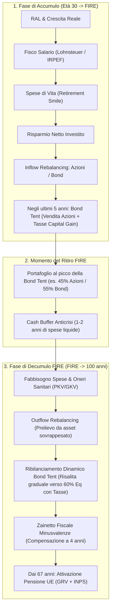

# Documento di Modellazione Matematica, Finanziaria e Manuale Utente
## FIRE Calculator Multi-Asset (Germania 🇩🇪 / Italia 🇮🇹)

---

## 1. Visione d'Insieme del Problema

Il simulatore risolve il problema della **pianificazione dell'Indipendenza Finanziaria e Ritiro Anticipato (FIRE)** per un lavoratore residente in Germania o in Italia con orizzonte di vita fino a 100 anni.

L'obiettivo è determinare:
1. **A quale età è sostenibile smettere di lavorare** garantendosi una probabilità $\ge 99\%$ di non esaurire il patrimonio prima dei 100 anni.
2. **Come proteggere il portafoglio dal rischio della sequenza dei rendimenti (*Sequence of Returns Risk - SRR*)** nei primi 5–10 anni dal ritiro.
3. **Come si combinano i redditi da lavoro, il decumulo del capitale privato e i trattamenti pensionistici pubblici europei (Germania GRV + Italia INPS)**, tenendo conto delle imposte sul reddito, dei contributi sanitari e della fiscalità sui mercati finanziari.



---

## 2. Architettura della Modellazione

### 2.1 Modello di Mercato: Joint Vector Block Bootstrap Sincrono
Nei simulatori Monte Carlo tradizionali si usano distribuzioni normali parametriche indipendenti. Nel mondo reale, questa assunzione fallisce gravemente (es. nel 1973-74 o nel 2022 azioni e bond sono crollati contemporaneamente con inflazione elevata).

- **Dataset Reale in EUR (1970–2024)**: contiene triplette annuali sincronizzate in valuta EUR:
  - Azionario: **MSCI World Net TR** (o **S&P 500 TR**) in EUR.
  - Obbligazionario: **German Bund 10-Year Total Return** (prezzo + cedole reinvestite in EUR).
  - Inflazione locale: **Destatis CPI** per la Germania, **Istat FOI** per l'Italia.
- **Joint Block Bootstrap (blocchi di 3 anni)**: ogni blocco campiona simultaneamente $t, t+1, t+2$ dalla storia reale. In questo modo:
  - Viene preservata la **correlazione incrociata reale** fra stock, bond e prezzi al consumo.
  - Viene preservata l'**autocorrelazione ciclica** (la durata media di un bear market pluriennale).

---

### 2.2 Modellazione Salariale e Fiscale del Lavoro

#### Germania 🇩🇪
- **Sozialabgaben (Contributi Sociali Dipendente)**:
  - Rentenversicherung (RV): $9.3\%$ (tetto Beitragsbemessungsgrenze ~90.600 € indicizzato all'inflazione).
  - Arbeitslosenversicherung (AV): $1.3\%$ (tetto ~90.600 € indicizzato).
  - Sanità GKV: $8.15\%$ KV + $2.2\%$ PV (tetto ~62.100 € indicizzato).
  - Sanità PKV: premio privato contrattuale con deduzione fiscale della quota base ($82\%$ ai sensi del § 10 EStG).
- **Lohnsteuer Progressiva**:
  - Grundfreibetrag (no-tax area ~11.784 € indicizzata).
  - Scaglioni progressivi reali ($14\% \to 42\%$).
  - Solidaritätszuschlag con *Milderungszone* (§ 4 SolzG) e Freigrenze a 18.130 €.

#### Italia 🇮🇹
- **Contributi IVS Lavoratore**: $9.19\%$ fisso sulla RAL.
- **IRPEF Progressiva**: aliquote $23\%$, $35\%$, $43\%$, detrazioni da lavoro dipendente a scalare fino a 15.000 € e addizionali regionali/comunali medie al $2\%$.
- **TFR Dipendenti**: accantonamento del $6.91\%$ della RAL annua rivalutato a $1.5\% + 75\%$ dell'inflazione, liquidato al momento del FIRE con tassazione separata ($23\%$).

---

### 2.3 Asset Allocation e Glidepath della Bond Tent (con Tassazione del Ribilanciamento)

Il modello prevede due regimi di portafoglio:
- **Accumulo ordinario**: tipicamente $80\%$ Azioni / $20\%$ Obbligazioni.
- **Ritiro FIRE**: target di lungo periodo $60\%$ Azioni / $40\%$ Obbligazioni.

```
Equity %
 80% |───────\ (Inizio Bond Tent: -5 anni al FIRE)
     |        \
 60% |         \                  /──────────────── (Regime FIRE Stazionario)
     |          \                /
 45% |           \──────────────/ (Minimo Equity al momento del FIRE)
     +────────────+──────────────+────────────────+
         Accumulo     FIRE       FIRE + 10 anni      Età 100
```

#### Come funziona la tassazione del ribilanciamento:
1. **Fase di discesa (ultimi 5 anni pre-FIRE)**:
   - I nuovi risparmi annui vengono prioritariamente convogliati nei bond (*Inflow Rebalancing* a costo fiscale zero).
   - Se i risparmi non bastano per abbassare la quota azionaria fino al minimo della tenda ($45\%$), **si vendono forzosamente quote azionarie**.
   - Sulla plusvalenza realizzata rispetto al prezzo fiscale medio di carico si paga l'imposta sul capital gain ($26.375\%$ DE con franchigia Sparer-Pauschbetrag, $26\%$ IT).
   - Solo il ricavato netto da imposte viene reinvestito in obbligazioni.
2. **Fase di risalita (primi 10 anni post-FIRE)**:
   - Man mano che si decumula, il target azionario risale gradualmente dal $45\%$ al $60\%$ ($+1.5\%$/anno).
   - Se i prelievi dal comparto bond non sono sufficienti a riallineare i pesi, si vendono obbligazioni per comprare azioni.
   - La plusvalenza obbligazionaria viene tassata ($12.5\%$ per governativi italiani, $26.375\%$ in Germania) e solo il netto viene reinvestito in azioni.
   - Eventuali minusvalenze pregresse nello zainetto fiscale abbattono l'imponibile prima del calcolo dell'imposta.

---

### 2.4 Strategia di Prelievo in FIRE: Buffer, Guardrails e Retirement Smile

1. **Retirement Smile**: le spese reali non sono piatte:
   - Età $< 55$: $100\%$ della spesa base desiderata.
   - Età $55 \to 75$: calo a $88\%$ (minore mobilità e spese ricreative stabilizzate).
   - Età $> 75$: risalita a $105\%$ (aumento spese di assistenza e sanitarie).
2. **Cash Buffer Dinamico (1–2 anni di spese)**:
   - Se l'azionario è in crescita: il buffer viene rifornito fino a 2 anni di spese.
   - Se l'azionario è in calo: il buffer non viene rifornito e si attinge alla liquidità per evitare vendite forzate a mercato depresso.
3. **Guardrails di Spesa (Guyton-Klinger light)**:
   - Se il tasso di prelievo istantaneo supera il $5\%$ del patrimonio disponibile, o supera il $4\%$ durante un bear market azionario, le spese discrezionali vengono tagliate del $10\%$.

---

### 2.5 Totalizzazione Europea dei Diritti Pensionistici (Regolamento UE 883/2004)

Un lavoratore che ha lavorato in più Stati membri UE non perde i contributi versati:
- **Cumulo dei periodi assicurativi per il diritto**: gli anni in Italia e Germania si sommano per superare le soglie minime di accesso (*Wartezeit* di 5 anni in Germania, 20 o 5 anni in Italia).
- **Calcolo Pro-Rata indipendente**:
  - **Quota Tedesca (GRV)**: calcolata in *Entgeltpunkte* (EP) sul reddito relativo alla media tedesca (*Durchschnittsentgelt* ~45.358 €) moltiplicata per l'attuale *Aktueller Rentenwert* (~39.32 €/mese per punto) indicizzato alla crescita reale dei salari e all'inflazione.
  - **Quota Italiana (INPS)**: montante contributivo rivalutato al tasso di capitalizzazione (PIL reale + inflazione) e convertito in rendita a 67 anni (o 71 anni se $< 20$ anni totali UE) tramite i coefficienti di trasformazione ministeriali ufficiali.

---

### 2.6 Regime Sanitario in Germania (PKV vs GKV)

La sanità tedesca è un fattore critico per il FIRE autonomo:
- **In Accumulo (Dipendente)**: datore di lavoro e dipendente condividono il premio.
- **In FIRE prima dei 67 anni**: il datore non contribuisce più. Chi ha la PKV deve pagare il **$100\%$ del premio** di tasca propria (indicizzato a inflazione medica extra dell'$1\%$/anno per invecchiamento). Chi è volontario in GKV paga la tariffa minima/proporzionale autonoma.
- **In Pensione canonica (dai 67 anni)**: la Deutsche Rentenversicherung (DRV) versa il sussidio pubblico del **$8.15\%$ della pensione lorda** (*Beitragszuschuss* § 106 SGB VI) per alleggerire il costo del premio PKV.

---

## 3. Matrice Concettuale: Cosa è Modellato vs Cosa NON è Modellato

| Ambito di Modellazione | Cosa È Implementato nel Modello | Cosa NON È Modellato (Ipotesi e Semplificazioni) |
| :--- | :--- | :--- |
| **Mercati & Rendimenti** | • Triplette storiche sincronizzate reali in EUR (Stock, Bond Bund 10Y TR, Inflazione).<br>• Joint Vector Block Bootstrap (durata blocchi 3 anni).<br>• TER annuo ETF e imposta di bollo sul dossier. | • Nessuna correlazione con valute non-EUR (il dataset converte tutto in EUR prima del campionamento).<br>• Esclusi investimenti immobiliari fisici, oro o crypto. |
| **Fisco Salariale** | • Scaglioni progressivi reali Lohnsteuer + Soli Milderungszone (DE).<br>• IRPEF a scaglioni + addizionali + IVS dipendente (IT).<br>• Indicizzazione delle soglie fiscali all'inflazione (neutralizzazione fiscal drag). | • Non sono modellate deduzioni straordinarie per figli a carico, spese di ristrutturazione edilizia o assegni familiari (*Kindergeld*). |
| **Bond Tent & Ribilanciamento** | • Transizione graduale di 5 anni prima del FIRE e risalita in 10 anni.<br>• Tassazione analitica delle plusvalenze durante le vendite di ribilanciamento.<br>• Zainetto fiscale quadriennale per compensazione minusvalenze. | • Si ipotizza ribilanciamento annuale discreto a fine anno (non continuo con soglie intraday).<br>• Non modellate commissioni fisse del broker (assunto broker low-cost con commissioni percentuali trascurabili). |
| **Pensioni Pubbliche** | • Regolamento UE 883/2004 con totalizzazione anni pregressi + futuri.<br>• Calcolo in Entgeltpunkte (DE) e contributivo puro con coefficienti di trasformazione (IT).<br>• Perequazione automatica all'inflazione su entrambe le quote. | • Non modellata la pensione anticipata contributiva italiana a 64 anni con soglia di importo (fissata soglia a 67 o 71 anni).<br>• Esclusa previdenza complementare privata di categoria (fondi pensione chiusi o *Riester/Rürup*). |
| **Sanità (Germania)** | • Costo a carico del lavoratore dipendente con deduzione § 10 EStG.<br>• Costo 100% a carico nel FIRE pre-67 con inflazione medica annua ($+1\%$).<br>• Sussidio DRV ($8.15\%$) dai 67 anni per titolari PKV. | • Non modellato il passaggio d'ufficio da PKV a GKV dopo i 55 anni (praticamente precluso dalla legge tedesca SGB V). |
| **Demografia & Vita** | • Orizzonte deterministico fino a 100 anni.<br>• Retirement Smile (spese a forma di U durante la vita). | • Non ci sono tabelle attuariali di probabilità di morte anno per anno: l'obiettivo è la sopravvivenza del portafoglio all'età target di 100 anni. |

---

## 4. Domande Frequenti sulla Modellazione (FAQ per Audit di Alto Livello)

### D1: Perché gli anni con tasso di successo al 99% sono più lontani rispetto a una classica regola del 4%?
> **Risposta**: La regola del 4% di Trinity fu calcolata su un orizzonte di soli **30 anni** e al lordo delle imposte. In questo modello:
> 1. L'orizzonte di vita arriva a **70 anni di decumulo** (da 30 a 100 anni).
> 2. Sono dedotte le imposte sul capital gain ad ogni ribilanciamento e prelievo.
> 3. C'è il costo sanitario integrale (in Germania fino a 780 €/mese indicizzati).
> 4. La soglia richiesta non è il 95% o il 90%, ma il **$99\%$ di certezza matematica**.

### D2: C'è il rischio che la Bond Tent aumenti le tasse pagate?
> **Risposta**: **Sì, ed è esattamente ciò che il modello ora quantifica.** Vendere azioni per comprare obbligazioni prima del FIRE cristallizza plusvalenze e genera un debito d'imposta immediato. Il modello mostra se il beneficio di abbattere il *Sequence of Returns Risk* supera il costo fiscale (*tax drag*) del ribilanciamento.

### D3: Come viene gestita l'inflazione sulle pensioni?
> **Risposta**: Le pensioni pubbliche (sia tedesca che italiana) godono di perequazione automatica: vengono rivalutate anno per anno in base al fattore di inflazione cumulata locale, preservando il potere d'acquisto reale.

### D4: Cosa succede se muoio prima dei 100 anni?
> **Risposta**: Il modello calcola il portafoglio in ipotesi conservativa di massima longevità (100 anni). Se il decesso avviene prima, il patrimonio residuo (visibile nella curva mediana o del 1° percentile del Fan Chart) costituisce l'asse ereditario netto.

---

## 5. Manuale Utente della Dashboard Streamlit

```
┌────────────────────────────────────────────────────────────────────────┐
│  🔥 FIRE Calculator — Controlli Principali (Barra Superiore)           │
│                                                                        │
│  [ Slider Età Ritiro FIRE: 45 Anni ] ────────────── Imposta tutto l'applicativo
│                                                                        │
│  ┌────────────────┐ ┌────────────────┐ ┌────────────────┐ ┌──────────┐ │
│  │ Prob. a 100a   │ │ Patr. al FIRE  │ │ Pensione UE    │ │ Spesa/a  │ │
│  │     99.4%      │ │   1.450.000 €  │ │  22.400 €/anno │ │ 24.000 € │ │
│  └────────────────┘ └────────────────┘ └────────────────┘ └──────────┘ │
└────────────────────────────────────────────────────────────────────────┘
```

### 5.1 Sidebar (Parametri di Input)
1. **Quadro Territoriale & Carriera**:
   - Scegli tra **Germania** e **Italia**.
   - Inserisci gli anni già lavorati in Italia e Germania (per la totalizzazione UE).
2. **Profilo Personale & Reddito**:
   - Età iniziale, età pensione di vecchiaia (67), orizzonte (100).
   - Capitale iniziale investito, RAL lorda attuale e crescita reale annua stimata.
3. **Regime Sanitario (se Germania)**:
   - Scegli tra **PKV Privata** (imposta premio a carico tuo e premio in FIRE) o **GKV Pubblica**.
4. **Asset Allocation & Mercati**:
   - Seleziona **MSCI World TR** o **S&P 500 TR**.
   - Imposta la quota azionaria desiderata in Accumulo (default $80\%$) e in FIRE (default $60\%$).
   - Spunta **Bond Tent (Glidepath anticrisi)**: abilitata di default.
5. **Pulsante "Esegui / Ricalcola Simulazione"**: ricalcola l'intero motore Monte Carlo quando modifichi parametri strutturali nella sidebar.

---

### 5.2 Barra Superiore Unificata
- **Slider Età Ritiro FIRE**: muovendo questo unico slider, tutte le metriche, i grafici delle 4 tab e il report PDF si aggiornano istantaneamente sull'età selezionata.
- **Metriche KPI**:
  1. *Probabilità Capitale > 0 a 100 anni* per l'età selezionata.
  2. *Patrimonio Accumulato al FIRE*.
  3. *Pensione Pubblica Totale UE* netta stimata a 67 anni.
  4. *Spesa Annua Obiettivo*.

---

### 5.3 Navigazione tra le 4 Schede (Tab)

#### Tab 1: 🎯 Heatmap (Successo & SWR)
- **Heatmap 1 (Tasso di Successo)**: mostra la percentuale di scenari con patrimonio integro per ogni combinazione tra età di ritiro FIRE (righe) ed età raggiunta (colonne dai 67 ai 100 anni).
- **Heatmap 2 (Sostenibilità SWR)**: mostra la percentuale di scenari in cui il tasso di prelievo rolling su 3 anni si mantiene al di sotto del benchmark di sicurezza ($3.14\%$).
- I valori percentuali numerici sono **sempre visibili** all'interno delle celle.

#### Tab 2: 📈 Evoluzione Patrimonio & Stress Test
- **Fan Chart Monte Carlo**: visualizza le fasce percentili $10^\circ–90^\circ$, l'interquartile $25^\circ–75^\circ$, la **mediana ($50^\circ$)** e la curva critica del **1° percentile peggiore** (lo scenario di stress estremo).
- **Scala Y**:
  - *Scala Logaritmica (Symlog) - Default*: permette di apprezzare sia i primi anni di crescita sia il comportamento a fine vita senza schiacciare i valori.
  - *Scala Lineare*: visualizzazione tradizionale in euro nominali.
- **Stress Test Storici Sovrapposti**: 4 scenari storici reali attivi di default:
  - *Bolla Dot-Com 2000* (bear market di 3 anni).
  - *Crisi Subprime 2008* (crollo rapido e rimbalzo).
  - *Stagflazione 1973* (inflazione elevata + crollo simultaneo azioni e bond).
  - *Doppio Shock 2022* (rialzo tassi ECB: Bund -20% e azioni in calo).

#### Tab 3: 🏛️ Spese e Pensioni UE (GRV + INPS)
- **Grafico Entrate vs Spese**: evidenzia lo stipendio netto in busta paga, lo stop immediato al momento del FIRE (fase a entrate zero da lavoro coperta dal portafoglio), e la successiva ripresa con l'erogazione delle pensioni pubbliche rivalutate dai 67 anni.
- **Grafico Trattenute, Fisco e Sanità**: disaggregazione dettagliata anno per anno tra contributi previdenziali, assicurazione disoccupazione, imposta sul reddito (Lohnsteuer/IRPEF), solidarietà e spesa sanitaria (PKV/GKV).

#### Tab 4: 📥 Riepilogo & Esportazione Piano
- **Tasti di Esportazione in Primo Piano (in alto)**:
  - `Scarica Tabella CSV (Excel)`: scarica il file `.csv` formattato con separatore `;` e codifica UTF-8 BOM per Microsoft Excel.
  - `Scarica Report PDF Esecutivo`: genera e scarica con un clic il **dossier executive di 4 pagine A4 orizzontali ad alta risoluzione**, completo di grafici vettoriali, tabelle di stress test e proiezioni.
- **Tabella Numerica Completa Anno per Anno (in basso)**:
  - Riporta per ogni anno: età, fase di vita, colonna dedicata **Allocazione (Azioni / Bond)** con l'evoluzione del glidepath, RAL, stipendio netto, imposte/sanità, risparmio, spese, pensione UE, prelievo netto e valore del portafoglio nel **1° percentile peggiore** e nella **mediana**.
